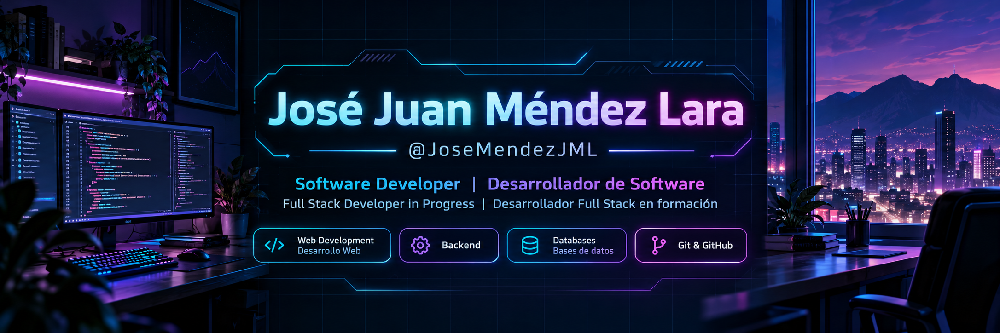

  

### Sobre mí

- Actualmente estoy estudiando Ingeniería en Desarrollo y Gestión de Software.
- Me interesa el desarrollo Full Stack y la ingeniería de software.
- Tengo experiencia académica desarrollando aplicaciones web y trabajando con bases de datos.
- Me gusta aprender nuevas tecnologías y trabajar en equipo.

### Tecnologías y herramientas

<h3>Lenguajes y tecnologías</h3>

<h4>Frontend</h4>

<h4>Backend y bases de datos</h4>

<h4>Desarrollo móvil</h4>

<h4>Herramientas de desarrollo</h4>

### Estadísticas de GitHub

### Proyectos destacados

#### LumaTek | Sistema Inteligente de Gestión de Invernaderos

LumaTek es un proyecto de desarrollo de software enfocado en
la gestión y monitoreo inteligente de invernaderos.

El sistema busca facilitar la administración de cultivos
mediante una plataforma web y la integración de sensores IoT.

**Tecnologías utilizadas:**

- Backend: PHP y Laravel
- Base de datos: MySQL
- Frontend: HTML, CSS y JavaScript
- Control de versiones: Git y GitHub
- IoT: ESP32 y sensores ambientales (en desarrollo)

**Mi participación en el proyecto:**

- Desarrollo e implementación de funcionalidades web.
- Diseño y gestión de bases de datos.
- Implementación de validaciones y pruebas.
- Colaboración mediante ramas y pull requests en GitHub.

**Repositorio:**

[Ver proyecto LumaTek en GitHub](https://github.com/JoseMendezJML/LumaTek-Web)

---

---

### Gracias por visitar mi perfil

*Siempre aprendiendo, programando y mejorando.*

